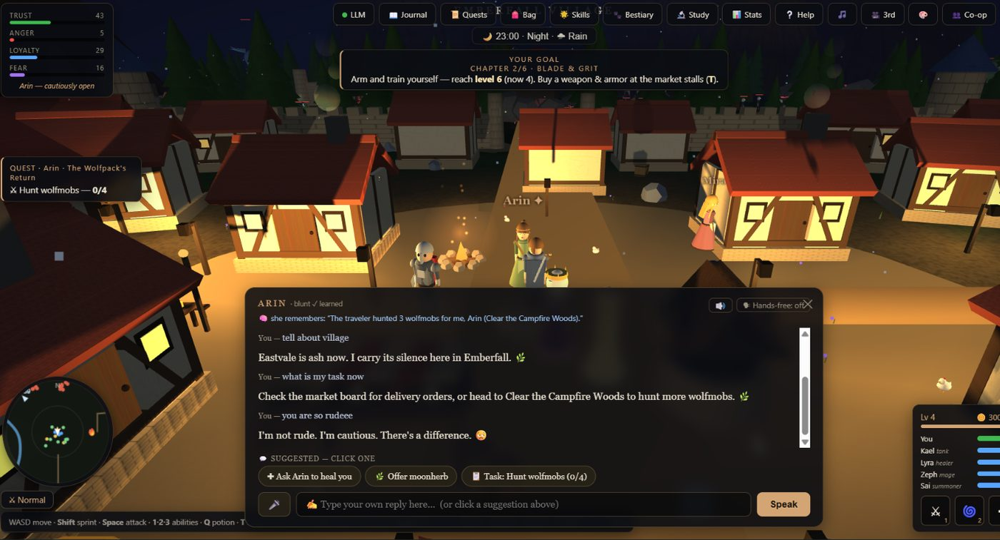
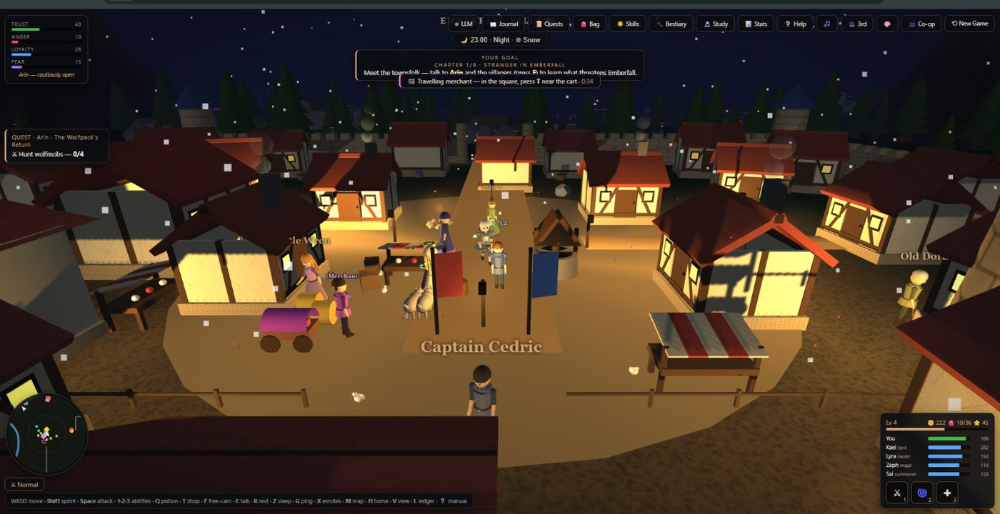
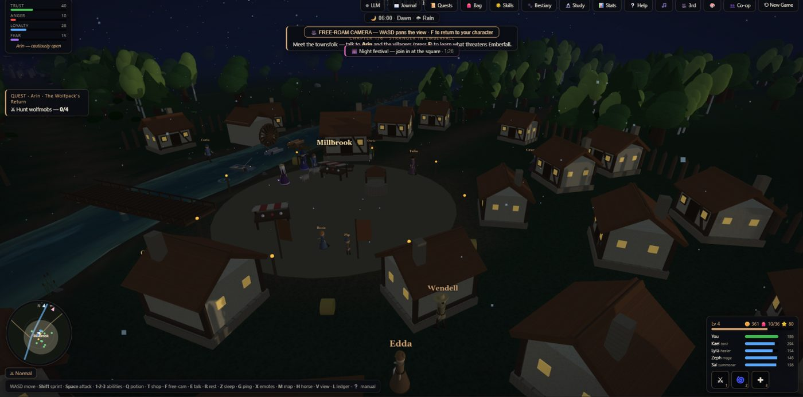
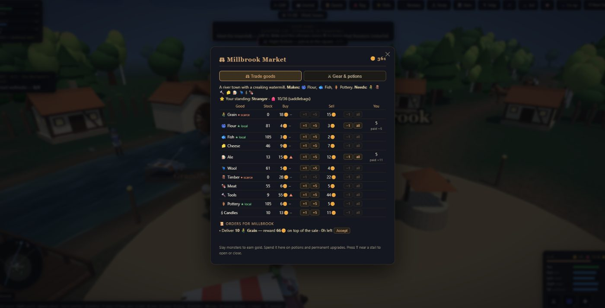
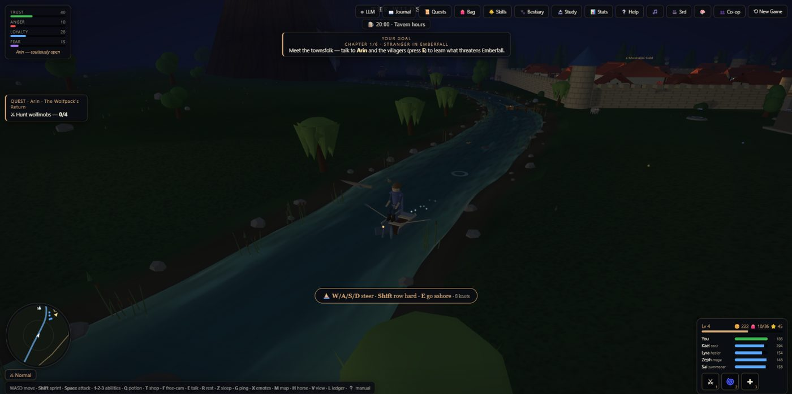
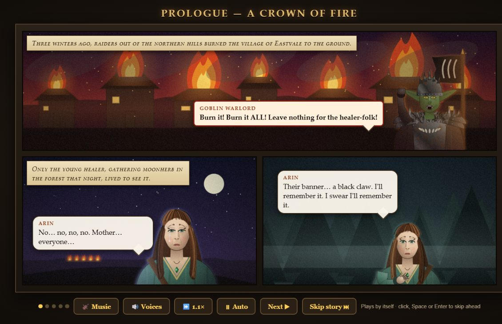
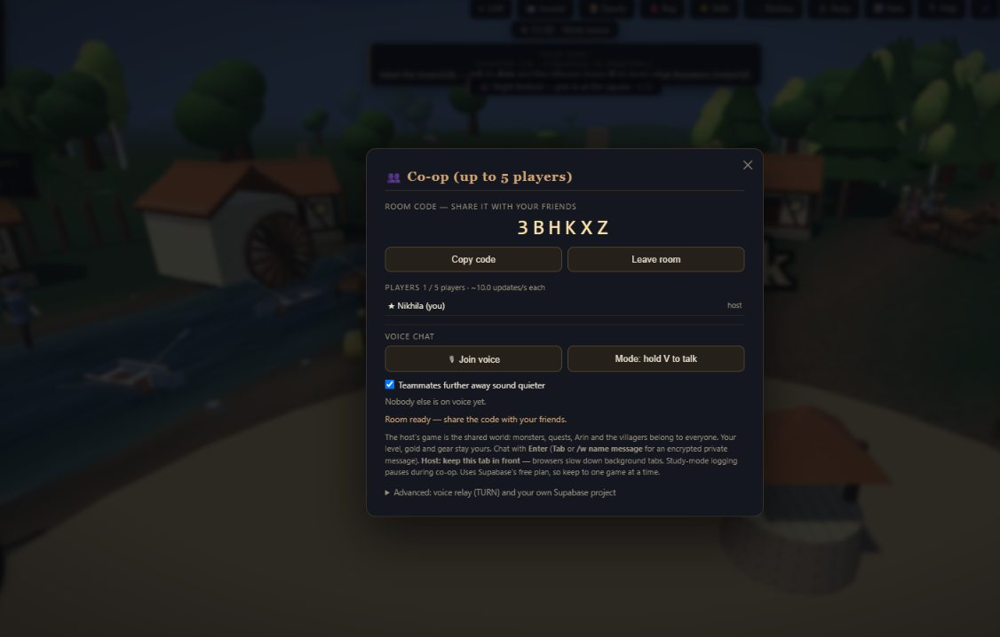
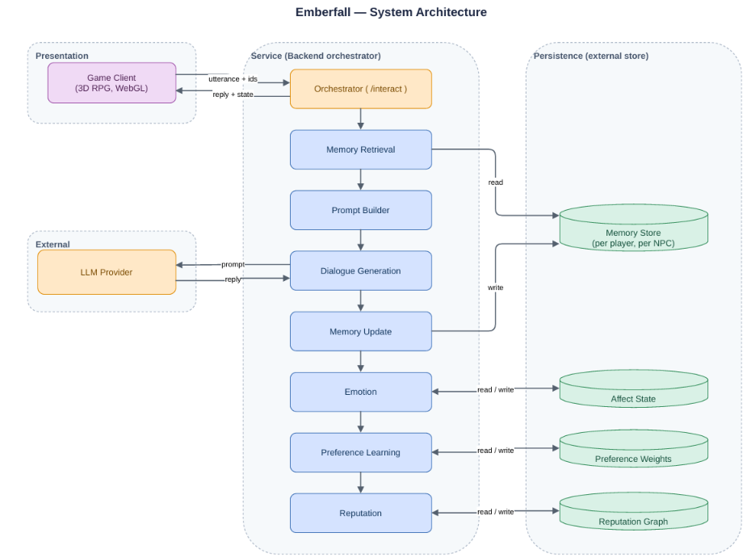

# Emberfall 3D

**Memory-augmented agentic NPCs for persistent, adaptive conversations in an open-world RPG.**

Emberfall is a browser-based 3D role-playing game whose characters are driven by a large language model (LLM). Unlike scripted game characters, they **remember each player across sessions**, keep an **emotional stance** towards each player (trust, anger, loyalty and fear), and **learn how each player likes to be spoken to**. The game also ships with a research harness, so every one of these mechanisms can be switched on and off and measured.

The whole game is a single HTML file. There is nothing to install and no server to run.



---

## Table of contents

- [Features](#features)
- [Quick start](#quick-start)
- [Connecting a language model](#connecting-a-language-model)
- [Playing together (co-op)](#playing-together-co-op)
- [Controls](#controls)
- [How it works](#how-it-works)
- [Research mode and results](#research-mode-and-results)
- [Tech stack](#tech-stack)
- [Repository structure](#repository-structure)
- [Privacy and keys](#privacy-and-keys)
- [Team](#team)
- [Citation](#citation)
- [License](#license)

---

## Features

**AI characters**
- **Dyadic episodic memory**: every memory belongs to one player–character pair and survives between sessions.
- **Bounded retrieval**: only the four most relevant memories go into each prompt, so the prompt stays the same size however long the relationship lasts.
- **Emotion model**: trust, anger, loyalty and fear change after every turn and slowly return to a baseline; the current mood shows as an emoji above each character.
- **Speaking-style learning**: characters learn whether each player prefers a gentle, neutral or blunt manner from the replies the player picks.
- **Short replies with emojis**: 1–2 sentences, under 25 words, with fitting emojis (emojis are never read aloud by the voice).
- **Gossip and AI-written quests**: villagers pass on what you did, and characters write new quests from their memories.

**Game world**
- Walled village of Emberfall plus five more towns, a river, forests and roads.
- Combat with abilities, potions, companions, smarter monster packs and three-phase bosses.
- **Level-up system**: 20 levels, XP curve `78 × level^1.5`, skill points for Power, Vitality, Critical hit, Life-leech and Haste.
- **Dynamic world**: weather that changes play (rain, storm, fog, snow), day–night cycle with villager routines, random world events (raids, merchant, night festival, wounded stranger).
- **Travel**: tame and ride horses, take coaches between towns, row boats along the river.
- **Trade economy**: 18 goods, supply-and-demand prices, delivery orders, town standing, travelling peddlers and market events.
- Illustrated comic-book story intro, a training manual and an interactive training yard.
- Voiced characters, adaptive music and a live orchestral score, all generated in the browser.

**Multiplayer**
- Online co-op for **up to 5 players** with a 6-letter room code.
- Text chat, end-to-end encrypted private whispers, push-to-talk voice chat, map pings and emotes.
- Team puzzles (Twin Seals vaults) and shared boss fights and world events.

| | | |
|---|---|---|
|  |  |  |
| Snow at night, travelling merchant event | Night festival in Millbrook | Town market with live prices |
|  |  |  |
| Rowing on the river | Comic-book story intro | Co-op room panel |

---

## Quick start

**Option 1: play online (GitHub Pages)**
After this repository is published with GitHub Pages enabled (see below), open:
`https://<your-username>.github.io/<repository-name>/`

**Option 2: open the file**
1. Download or clone this repository.
2. Open `index.html` in **Chrome** or **Edge** (recommended). Firefox works for the game; voice input needs Chrome or Edge.

**Option 3: run a tiny local web server** (recommended if you use a local model such as Ollama)
```bash
python -m http.server 8000
# then open http://localhost:8000
```

An internet connection is needed the first time, because three.js, PeerJS, Supabase and transformers.js are loaded from public CDNs.

### Publishing with GitHub Pages
Repository **Settings → Pages → Build and deployment → Source: Deploy from a branch → Branch: `main` / root → Save**.
After a minute the game is live at the address shown on that page. The empty `.nojekyll` file makes GitHub serve the files as they are.

---

## Connecting a language model

Click **LLM** in the top bar, choose a preset, enter a key if needed, then click **Test**.

| Preset | Endpoint | Model | Notes |
|---|---|---|---|
| **Groq** (used in our experiments) | `https://api.groq.com/openai/v1` | `llama-3.3-70b-versatile` | Free API key from console.groq.com |
| OpenAI | `https://api.openai.com/v1` | `gpt-4o-mini` | Paid API key |
| Ollama (default, offline) | `http://localhost:11434/v1` | `llama3.2` | Install Ollama, run `ollama pull llama3.2`; start it with `OLLAMA_ORIGINS=*` so the browser may call it |
| LM Studio | `http://localhost:1234/v1` | your loaded model | Enable the local server in LM Studio |

Any **OpenAI-compatible** chat-completions endpoint works. Your key is stored only in your own browser (localStorage) and is sent only to the endpoint you choose.

Without a model the world, combat, travel and trade still work; characters answer only once a model is connected.

---

## Playing together (co-op)

1. Click **Co-op**, type your name and click **Host a game**. A 6-letter room code appears.
2. Send the code to up to four friends. They open the game, enter the code and click **Join**.
3. The host's game is the shared world (monsters, quests, Arin and the villagers). Each player keeps their own level, gold and gear.

**Networks.** The host connects over two networks at once: **Supabase Realtime** and a **PeerJS** backup (free, no account). Joiners use whichever works, so co-op keeps running if one is blocked or asleep.

**If players cannot connect**
- Everyone must use the **same version** of `index.html`.
- College and office Wi-Fi often blocks direct browser-to-browser links. Add a free TURN relay (for example Metered "Open Relay") under **Co-op → Advanced → Voice relay (TURN) URL** on **every** computer, or use a mobile hotspot.
- To use your own Supabase project, paste its URL and publishable key under **Co-op → Advanced**. Free Supabase projects pause after a week without use; restore them from the Supabase dashboard.
- **Same-computer test:** open the game as `index.html?net=local` in two tabs of one browser; this needs no internet connection for co-op.

More detail: [docs/MULTIPLAYER.md](docs/MULTIPLAYER.md).

---

## Controls

| Key | Action | Key | Action |
|---|---|---|---|
| W A S D | Move | Shift | Sprint / gallop / row hard |
| Space | Attack | 1 2 3 | Abilities |
| Q | Drink potion | E | Talk / interact / board |
| T | Shop or market (near a stall) | L | Trade ledger |
| K | Skills | M | Map |
| H | Mount, dismount or whistle your horse | V | First/third-person view (hold to talk when voice chat is on) |
| F | Free-roam camera | R / Z | Rest / sleep |
| G | Map ping | X | Emotes |
| Enter | Co-op chat | ❔ | Help and training manual |

Full list: [docs/CONTROLS.md](docs/CONTROLS.md).

---

## How it works



Emberfall follows a **retrieval-first invariant**: the language model never stores anything itself. Every turn:

1. **Input**: the player speaks to a character (typed or by voice).
2. **Retrieve**: the top four memories for this player–character pair are fetched.
3. **State**: emotion, learned speaking style and reputation are added to the prompt.
4. **Generate**: the LLM returns a short reply plus small state changes as JSON.
5. **Update**: memory, emotion and style are saved for the next visit (browser localStorage, human-readable JSON).

More detail: [docs/ARCHITECTURE.md](docs/ARCHITECTURE.md).

---

## Research mode and results

The **Study** panel turns each mechanism (memory, emotion, preference learning, reputation) on or off, shows live metrics, and exports each session as JSON or CSV. Demo buttons trigger world events, bosses and weather on demand.

Highlights from our mechanism-level evaluation on **EMBER-PROBE** (720 events, 1,440 probes with known target memories):

| Result | Value |
|---|---|
| Lexical retrieval, same wording (Hit@1 / Hit@4) | 0.919 / 0.994 |
| Generative-Agents and MemoryBank scorers (Hit@4) | 0.668 / 0.711 |
| Same retrieval when the player rephrases (Hit@4) | 0.068 |
| With a pretrained meaning-based encoder (Hit@4) | 0.528 |
| Events still stored at capacity 30 | about 50% |

More detail: [docs/RESEARCH.md](docs/RESEARCH.md).

---

## Tech stack

| Layer | Technology |
|---|---|
| Game client | HTML5, CSS, plain JavaScript (single file) |
| 3D graphics | three.js r128 (WebGL) |
| Audio and voices | Web Audio API, Web Speech API |
| AI dialogue | Any OpenAI-compatible LLM API (Llama 3.3 70B on Groq in our study) |
| In-browser NLP | transformers.js with all-MiniLM-L6-v2 (semantic memory) and DistilBERT SST-2 (tone) |
| Multiplayer | Supabase Realtime, PeerJS / WebRTC data channels, WebRTC voice |
| Persistence | Browser localStorage (JSON) |
| Evaluation | Python 3.11, NumPy, SciPy, scikit-learn, Matplotlib |

---

## Repository structure

```
emberfall/
├── index.html            # the complete game (open this)
├── README.md
├── LICENSE
├── CHANGELOG.md          # version history v01 → v32
├── CITATION.cff
├── .gitignore
├── .nojekyll             # lets GitHub Pages serve the files as they are
└── docs/
    ├── ARCHITECTURE.md
    ├── CONTROLS.md
    ├── MULTIPLAYER.md
    ├── RESEARCH.md
    └── images/           # screenshots and architecture diagram
```

---


## Citation

If you use Emberfall in your work, please cite it using the metadata in [CITATION.cff](CITATION.cff) (GitHub shows a "Cite this repository" button).

---

## License

Released under the [MIT License](LICENSE).
Third-party libraries loaded at runtime (three.js, PeerJS, supabase-js, transformers.js) are under their own licenses. LLM output is subject to the terms of the model provider you connect.
