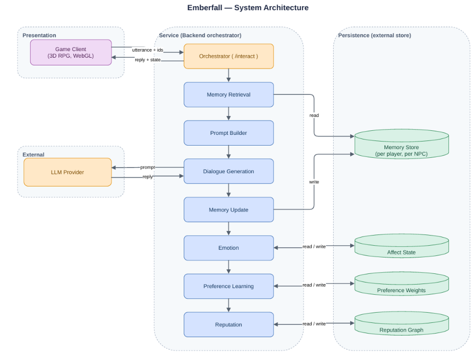

# Architecture

## Retrieval-first invariant
The language model holds no durable state. Persistent information lives outside the model, is retrieved before a reply is generated, and is written back after the turn. This keeps memory inspectable, keeps the prompt bounded, lets the model be swapped, and lets each mechanism be tested on its own.

## One conversational turn
| Stage | Input | What happens | Output |
|---|---|---|---|
| Receive | Player utterance and IDs | Identify the active player–character pair | Turn context |
| Retrieve | Query and memory store | Score and select the top 4 memories | Retrieved context |
| State read | Affect, register, reputation | Load the relationship state | Relational context |
| Prompt build | Persona, memories, state | Build a bounded prompt with a JSON output contract | Model prompt |
| Generate | Prompt | LLM call (OpenAI-compatible) | Reply and proposed state changes |
| Update | Reply, player choice | Apply bounded updates to affect, register and memory | New persistent state |
| Return | Reply | Trim to 1–2 sentences, add mood emoji if missing, show and speak | NPC response |

## Mechanisms
- **Memory**: per player–character records `(text, importance, turn, optional embedding)`. A record is stored when its importance is above 0.45; each pair keeps up to 30 records. Retrieval scores relevance plus importance and injects the top 4.
- **Affect**: `E(t+1) = clip(E(t) + clip(Δ, −δ, δ) + γ(B − E(t)), 0, 100)` for trust, anger, loyalty and fear, with decay γ toward baseline B.
- **Register learning**: weights over gentle / neutral / blunt; the chosen register is reinforced and the others decay toward a floor. Choice probability `π(s) = θs / Σθ`.
- **Reputation and gossip**: strong moments become rumours that spread between villagers, weaker with every retelling.

## Code layout inside `index.html`
The file is organised into clearly commented sections, for example: `STORY INTRO`, `RPG COMBAT MODULE`, `THE WIDER WORLD`, `TRAVEL`, `TRADE & TOWNSFOLK`, `WEATHER THAT AFFECTS PLAY`, `RANDOM WORLD EVENTS`, `CO-OP MULTIPLAYER`, `CO-OP SYNC`, `CO-OP VOICE CHAT`, `TEAM PUZZLES`, `END-OF-SESSION STATS`, `VISIBLE MOODS`. Search for these headings to find each system.

## Persistence
All state is saved in browser `localStorage` as human-readable JSON: memory store, affect state, register weights, reputation, plus level, gold, gear and quests.
